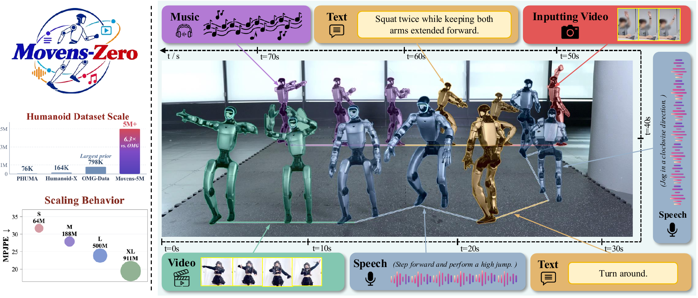

# Movens-Zero

### Scaling Humanoid Motion Foundation Models with Large-Scale Human Videos

Official repository for <strong>Movens-Zero</strong>.

  
  
  
  
  
  
  
  

  

Movens-Zero generates Unitree G1 whole-body motion from text, music, speech, and video.

## TODO

- [x] Self-contained inference runtime
- [x] Text, music, speech, and video inference
- [x] Motion representation and normalization
- [x] Pretrained checkpoint release
- [x] Training code
- [x] Benchmark evaluation
- [x] Sim-to-sim deployment
- [x] Sim-to-real deployment

## Table of Contents

- [1. Install](#1-install)
- [2. Download Models](#2-download-models)
- [3. Offline Inference](#3-offline-inference)
- [4. Training](#4-training)
- [5. Benchmark Evaluation](#5-benchmark-evaluation)
- [6. Sim2Sim](#6-sim2sim)
- [7. Sim2Real](#7-sim2real)
- [License](#license)
- [Citation](#citation)

## 1. Install

~~~bash
conda create -n movens-zero python=3.10 -y
conda activate movens-zero
pip install -e .
~~~

Music, speech, and video inference require FFmpeg and FFprobe.

~~~bash
conda install -c conda-forge ffmpeg
~~~

SDPA is used by default. FlashAttention 2 is optional:

~~~bash
pip install -e ".[flash]" --no-build-isolation
~~~

## 2. Download Models

The four releases contain the trained Qwen2.5-Omni backbone and the action expert.

| Model | Action-expert parameters | Layers / width | Checkpoint |
| --- | ---: | --- | --- |
| S | 64.2M | 3 / 768 | [Movens-Zero-S](https://huggingface.co/wendell0218/Movens-Zero-S) |
| M | 187.9M | 4 / 1,152 | [Movens-Zero-M](https://huggingface.co/wendell0218/Movens-Zero-M) |
| L | 500.1M | 6 / 1,536 | [Movens-Zero-L](https://huggingface.co/wendell0218/Movens-Zero-L) |
| XL | 910.5M | 7 / 1,920 | [Movens-Zero-XL](https://huggingface.co/wendell0218/Movens-Zero-XL) |

Download the default XL release; use `--model-size S`, `M`, or `L` for another size:

~~~bash
source scripts/download_models.sh
~~~

This writes `checkpoints/Movens-Zero-XL/model.safetensors` and a download receipt.

## 3. Offline Inference

### Text

~~~bash
source inference.sh \
  --mode text \
  --prompt "A person walks forward calmly." \
  --name walk_forward \
  --output-dir outputs/walk_forward
~~~

### Music

~~~bash
source inference.sh \
  --mode music \
  --input-path /path/to/music.wav \
  --prompt "Generate a dance sequence that matches the music." \
  --output-dir outputs/music_motion
~~~

### Speech

~~~bash
source inference.sh \
  --mode speech \
  --input-path /path/to/speech.wav \
  --prompt "Listen to the instruction and perform it." \
  --output-dir outputs/speech_motion
~~~

### Video

~~~bash
source inference.sh \
  --mode video \
  --input-path /path/to/video.mp4 \
  --prompt "Copy the motion in the video." \
  --output-dir outputs/video_motion
~~~

### Common Options

| Option | Description |
| --- | --- |
| <code>--model-size</code> | Select <code>S</code>, <code>M</code>, <code>L</code>, or <code>XL</code> (default) |
| <code>--checkpoint</code> | Override the full Movens-Zero checkpoint |
| <code>--backbone</code> | Use a local Qwen2.5-Omni-3B directory |
| <code>--initial-pose</code> | Override the included 36D G1 initial pose |
| <code>--num-output-frames</code> | Output length at 50 FPS, default: 300 |
| <code>--num-inference-steps</code> | Flow sampling steps, default: 10 |
| <code>--cfg-scale</code> | CFG strength, default: <code>1.5</code> |
| <code>--cfg-interval</code> | Noise-time interval for CFG, default: <code>0.2 0.8</code> |
| <code>--seed</code> | Random seed, default: <code>0</code> |
| <code>--device</code> | Torch device, default: <code>cuda:0</code> |
| <code>--attention-implementation</code> | Qwen attention backend: <code>sdpa</code> or <code>flash_attention_2</code> |

Use <code>inference.sh --mode text|music|speech|video</code> for all modalities.

### Outputs

Each output directory contains:

~~~text
joint_pos.csv
joint_vel.csv
body_pos.csv
body_quat.csv
body_lin_vel.csv
body_ang_vel.csv
motion.npy
metadata.json
~~~

## 4. Training

Train or fine-tune Movens-Zero with text, speech, music, and video conditioning.
The training code supports one or multiple GPUs and resuming saved training state.

After preparing the dataset and downloading a checkpoint, start training:

~~~bash
python training/train.py \
  --config configs/inference_xl.json \
  --manifest data/movens_demo/train.jsonl \
  --checkpoint checkpoints/Movens-Zero-XL/model.safetensors \
  --batch-size 4 --accumulation 4 --max-steps 30000 \
  --output runs/movens_zero
~~~

See the [training guide](https://github.com/wendell0218/Movens-Zero/tree/main/training)
for installation, data preparation, training parameters, and resume commands.

## 5. Benchmark Evaluation

Evaluate released or locally trained checkpoints on Movens-Intent's text, speech,
music, and video tracks. Each track provides paired conditions and reference motions.

After generating motions for the text track, compute its metrics:

~~~bash
python evaluation/score.py \
  --track text \
  --data-dir data/intent/text \
  --generation-dir outputs/intent/text \
  --output-dir outputs/intent/text/metrics
~~~

See the [evaluation guide](https://github.com/wendell0218/Movens-Zero/tree/main/evaluation)
for setup, data preparation, checkpoint inference, and evaluation of all four tracks.

## 6. Sim2Sim

Run Movens-Zero in MuJoCo with a whole-body controller, live robot-state
feedback, and real inference latency.

[Setup and simulation instructions](https://github.com/wendell0218/Movens-Zero/tree/main/sim2sim)

## 7. Sim2Real

Deploy Movens-Zero on a Unitree G1 with a GPU inference server and an onboard
whole-body controller. The client streams robot state and supports text,
speech, music, and video inputs.

[Setup and deployment instructions](https://github.com/wendell0218/Movens-Zero/tree/main/sim2real)

## License

Project-specific code and checkpoint license terms have not yet been specified.

Movens-Zero is improved using Qwen2.5-Omni-3B. Qwen weights are not distributed in this repository and remain subject to the [Qwen Research License](https://huggingface.co/Qwen/Qwen2.5-Omni-3B/raw/main/LICENSE), which permits non-commercial research and evaluation use unless a separate commercial license is obtained.

## Citation

~~~bibtex
@article{bu2026movenszero,
  title   = {Movens-Zero: Scaling Humanoid Motion Foundation Models with
             Large-Scale Human Videos},
  author  = {Wendong Bu and Tinghong Ye and Qizhou Wang and Jiacheng Li and
             Zhiqi Ge and Yuze Lin and Zhongqi Yue and Yi Su and Jingyu Wang and
             Kai Shen and Jingdong Liu and Chengyuan Deng and Xiaoxuan Chen and
             Xin Tan and Jiaming Ji and Wenqiao Zhang and Chenghong Jiang and
             Tuoyu Li and Siliang Tang and Jun Xiao and Tat-Seng Chua and
             Yueting Zhuang and Xingxing Wang and Juncheng Li},
  journal = {Technical Report},
  year    = {2026}
}
~~~
